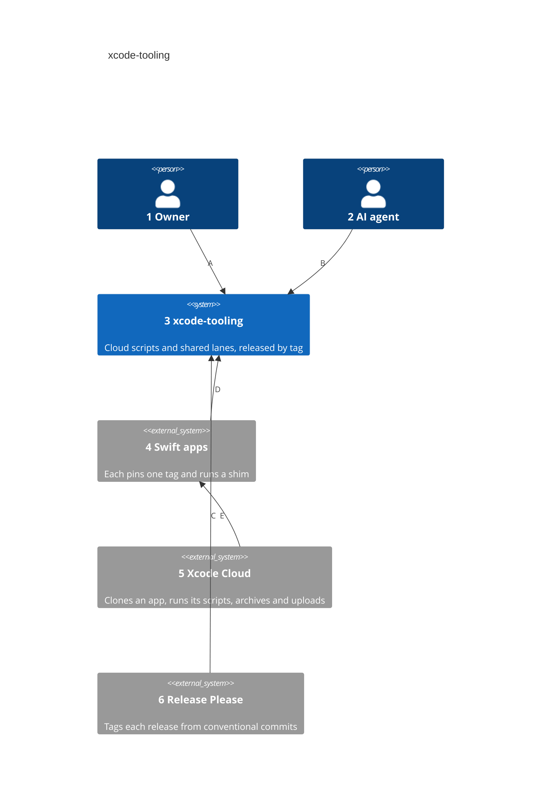
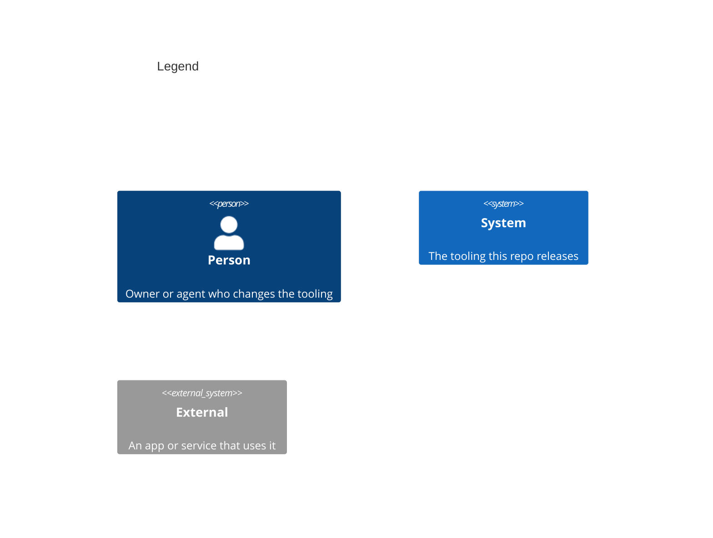

# System Context

Numbers on nodes and arrows match the callout table.

| #   | Description | Why |
| --- | --- | --- |
| 1   | Approves pull requests and the release they make. | Every change ships through a reviewed pull request. |
| 2   | Opens those pull requests. | Agents cannot approve their own work. |
| 3   | This repo: `ci_scripts/` and `fastlane/Fastfile`. | One source for every app's cloud scripts and lanes. |
| 4   | Each Swift app in the org, with its shim and version file. | An app names the exact release it runs. |
| 5   | Apple's build service, each app's only uploader. | It runs only scripts the app commits, so the shim fetches the rest. |
| 6   | The release workflow on main. | Versions come from commit types, with nothing new to run. |
| A   | Merges a change, then the release pull request. | The merge is the approval. |
| B   | Same path as the owner, ending at the owner's approval. | One flow for people and agents. |
| C   | Tags `vX.Y.Z` and moves `vX`. | A tag is what an app pins. |
| D   | The shim clones the pinned tag; the lane file imports the lanes from it. | A Mac and the cloud run the same release. |
| E   | Runs the app's `ci_post_clone.sh` and `ci_post_xcodebuild.sh`. | Both hand their name to the app's shim. |
