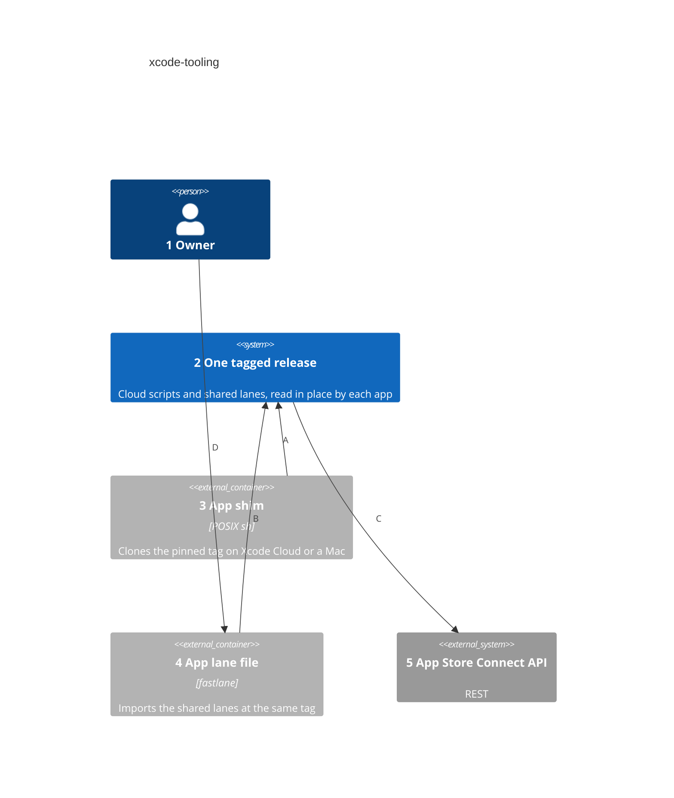
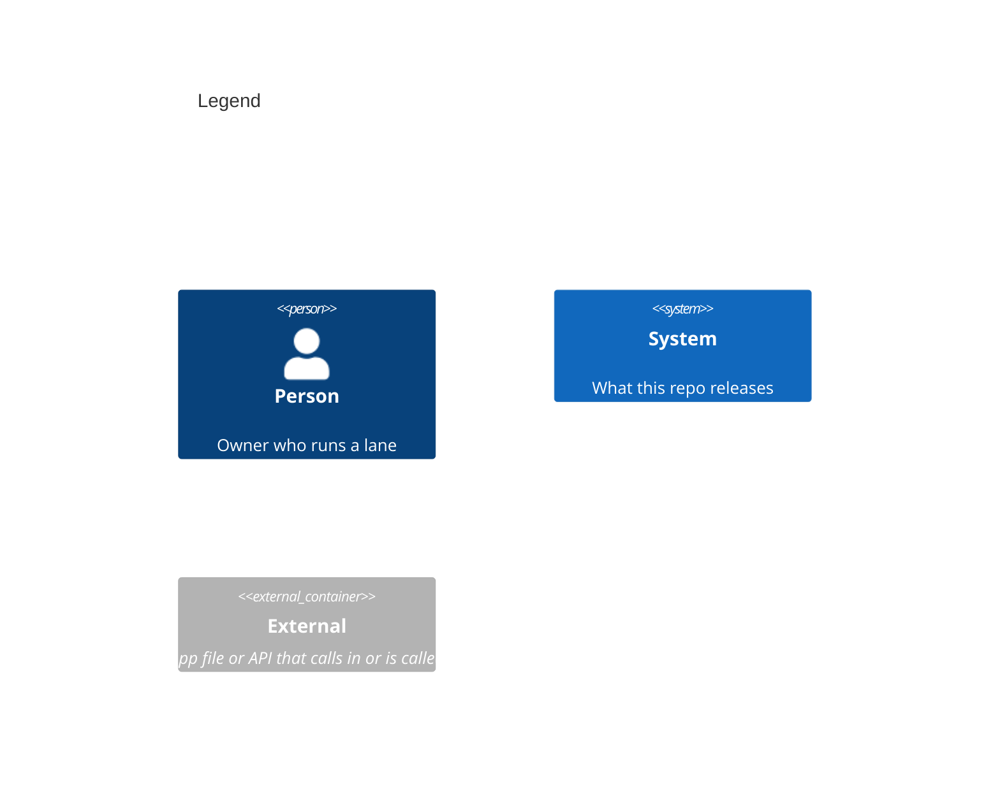

# Containers

Numbers on nodes and arrows match the callout table. Nothing here builds or deploys on its own. Each app's shim and lane file run the release in place, so this view draws no container here.

| #   | Role | Why |
| --- | --- | --- |
| 1   | Same actor as the system context. | Runs lanes on a Mac. |
| 2   | The cloud scripts and shared lanes at one tag. | Each app runs exactly the release it names. |
| 3   | The shim each app commits, run by its two hook scripts. | Apple runs only committed scripts. |
| 4   | The lane file each app owns, with its own lanes below the import. | fastlane's own way to share lanes. |
| 5   | Builds, tester groups and Xcode Cloud runs. | The team's API key signs each call. |
| A   | Clones the tag the app's version file names, and runs the script of the same name. | The app pins one release. |
| B   | `import_from_git` at the same tag. | A Mac runs what the cloud runs. |
| C   | Reads builds and groups, and starts a run on main. | Nothing here uploads a build. |
| D   | Runs `fastlane archive` or a status lane. | A Mac proves a build without uploading it. |
