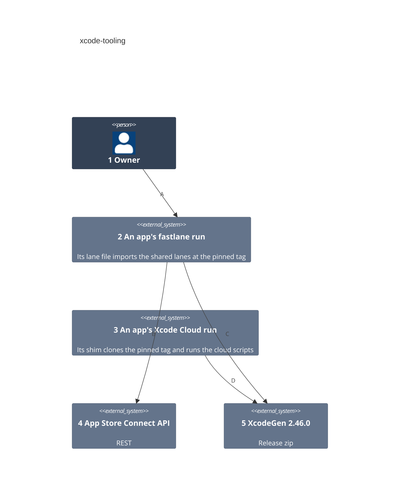
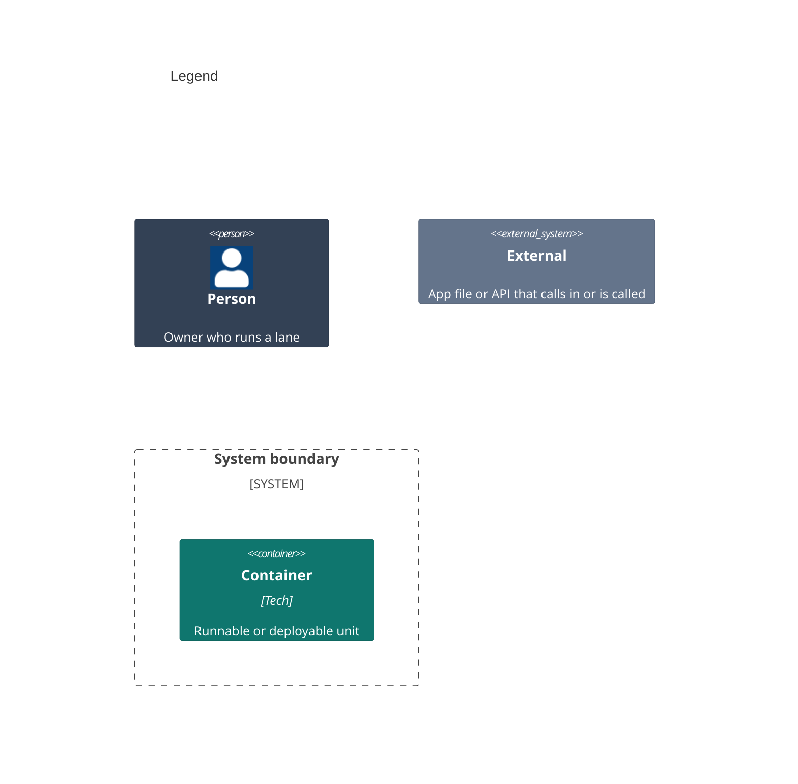

# Containers

Numbers on nodes and letters on arrows match the callout table. This repo ships no container: its scripts and lanes run inside each app's runs, from the tag the app pins. [03-components.md](03-components.md) shows their files.

| #   | Description | Why |
| --- | --- | --- |
| 1   | Same actor as the system context. | Runs lanes on a Mac. |
| 2   | `fastlane` in an app, on a Mac, with the shared lanes imported. | A Mac runs what the cloud runs. |
| 3   | Xcode Cloud building an app, whose shim fetches the cloud scripts. | Each app runs exactly the release it names. |
| 4   | Builds, tester groups and Xcode Cloud runs. | The team's API key signs each call. |
| 5   | The XcodeGen release the post-clone script downloads. | One generator version for every app. |
| A   | Runs `fastlane archive` or a status lane. | A Mac proves a build without uploading it. |
| B   | The shared lanes read builds and groups, and start a run on main. | Nothing here uploads a build. |
| C   | `archive` runs the post-clone script, which fetches XcodeGen. | Local and cloud projects match. |
| D   | The post-clone script fetches XcodeGen unless that version is installed. | A fresh cloud machine has none. |
