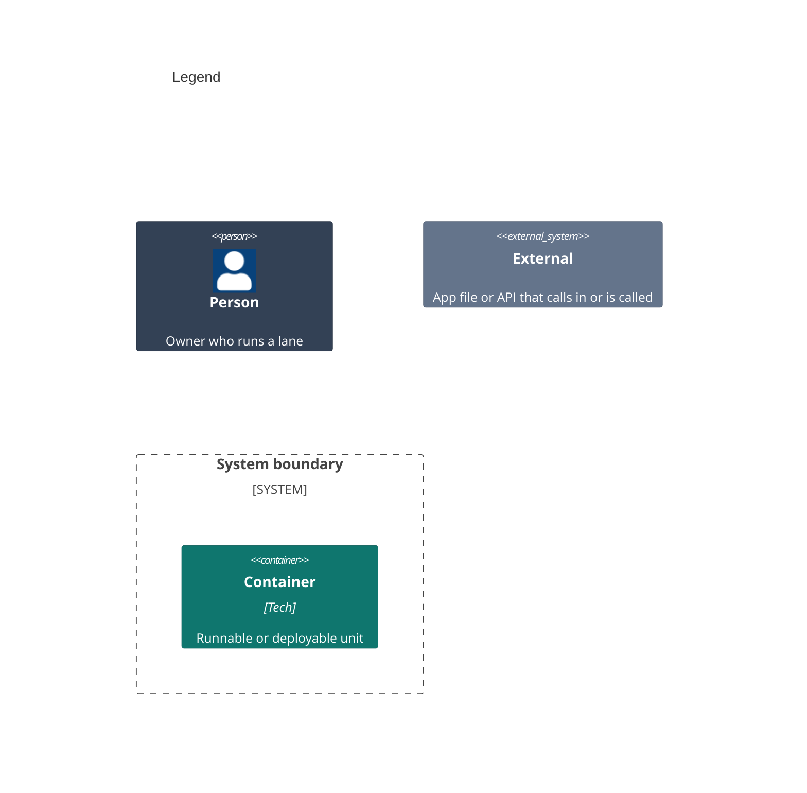

# Containers

```mermaid
C4Container
    title xcode-tooling

    Person(owner, "1 Owner")

    System_Boundary(release, "2 One tagged release") {
    }

    System_Ext(shim, "3 App shim", "Clones the pinned tag on Xcode Cloud or a Mac")
    System_Ext(laneFile, "4 App lane file", "Imports the shared lanes at the same tag")
    System_Ext(asc, "5 App Store Connect API", "REST")

    Rel(shim, release, "A")
    Rel(laneFile, release, "B")
    Rel(release, asc, "C")
    Rel(owner, laneFile, "D")

    UpdateElementStyle(owner, $bgColor="#334155", $borderColor="#1e293b", $fontColor="#ffffff")
    UpdateElementStyle(shim, $bgColor="#64748b", $borderColor="#475569", $fontColor="#ffffff")
    UpdateElementStyle(laneFile, $bgColor="#64748b", $borderColor="#475569", $fontColor="#ffffff")
    UpdateElementStyle(asc, $bgColor="#64748b", $borderColor="#475569", $fontColor="#ffffff")
```



Numbers on nodes and letters on arrows match the callout table. Nothing here builds or deploys on its own.

| #   | Description | Why |
| --- | --- | --- |
| 1   | Same actor as the system context. | Runs lanes on a Mac. |
| 2   | The cloud scripts and shared lanes at one tag, with no container: each app's shim and lane file run the release in place. | Each app runs exactly the release it names. |
| 3   | The shim each app commits, run by its two hook scripts. | It fetches the release the hooks name. |
| 4   | The lane file each app owns, with its own lanes below the import. | The app's way into the shared lanes. |
| 5   | Builds, tester groups and Xcode Cloud runs. | The team's API key signs each call. |
| A   | Clones the tag the app's version file names, and runs the script of the same name. | The app pins one release. |
| B   | `import_from_git` at the same tag. | A Mac runs what the cloud runs. |
| C   | Reads builds and groups, and starts a run on main. | Nothing here uploads a build. |
| D   | Runs `fastlane archive` or a status lane. | A Mac proves a build without uploading it. |
