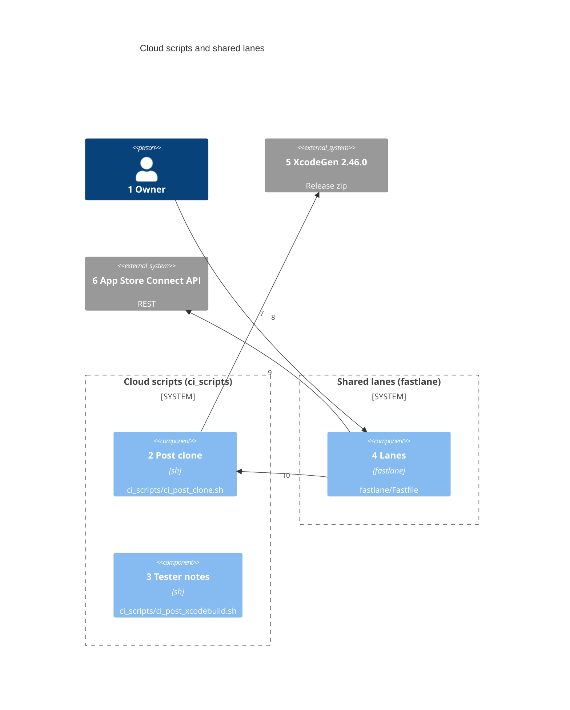
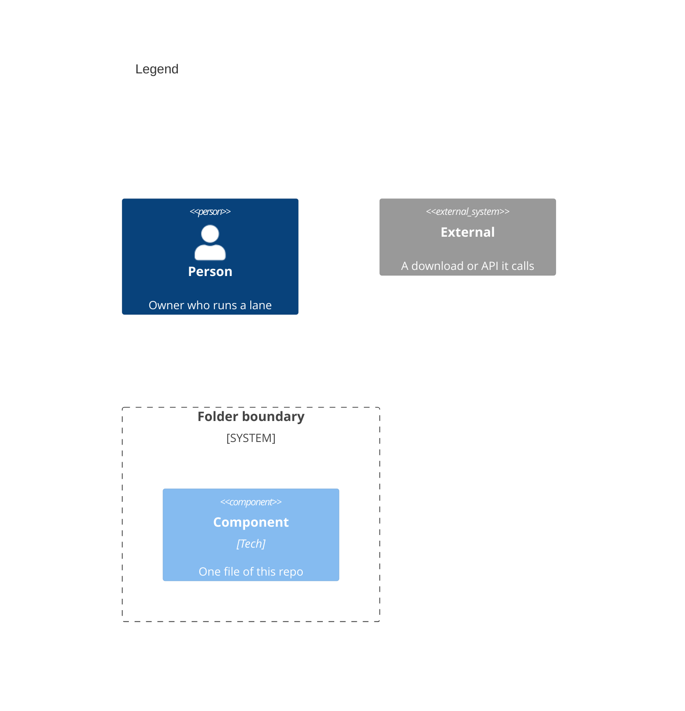

# Components

Numbers on nodes and arrows match the callout table.

| #   | Part | Why |
| --- | --- | --- |
| 1   | Same actor as the other views. | Runs a lane on a Mac. |
| 2   | `ci_scripts/ci_post_clone.sh` runs the app's `app_post_clone.sh`, then generates the project when `project.yml` exists. | One XcodeGen version for every run, per [0001](../requirements/0001-post-clone.md). |
| 3   | `ci_scripts/ci_post_xcodebuild.sh` writes the merge's changelog entry after an archive. | Testers read what changed, per [0002](../requirements/0002-tester-notes.md). |
| 4   | `fastlane/Fastfile` holds the shared lanes and their App Store Connect helpers. | The app's lane file imports it at the pinned tag. |
| 5   | The XcodeGen release zip on GitHub. | Checked by its SHA-256 before it runs. |
| 6   | The App Store Connect REST API. | Builds, groups and cloud runs live there. |
| 7   | Downloads XcodeGen unless that version is installed. | A fresh cloud machine has none. |
| 8   | Runs a lane through the app's lane file. | The app's Appfile and Gymfile name it. |
| 9   | Reads and starts runs with the team's key. | No lane uploads. |
| 10  | `archive` runs the app's post-clone hook, which reaches this script. | Local and cloud projects match. |
