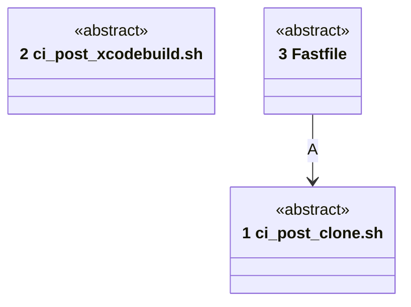
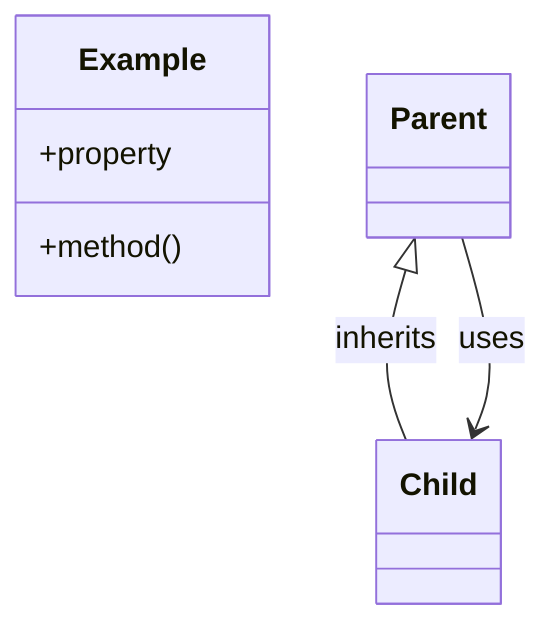

# Code

Numbers on classes and relationships match the callout table. The scripts and lanes are shell and Ruby, which no fitness language module reads, so each class is abstract.

| #   | Description | Why |
| --- | --- | --- |
| 1   | `ci_scripts/ci_post_clone.sh`: the app's step, then XcodeGen, installed or downloaded and checked. | The project is generated the same everywhere. |
| 2   | `ci_scripts/ci_post_xcodebuild.sh`: an `awk` pass over the merge's entry, cut at 4000 characters. | TestFlight's notes limit. |
| 3   | `fastlane/Fastfile`: `appfile_value`, `env_value`, `asc_api_key`, `store_app`, `managed_workflow`, `all_pages`, `repo_root`, and the four lanes. | Small helpers, each read by more than one lane. |
| A   | The `archive` lane runs the app's post-clone hook. | The shim reaches this release's script. |
