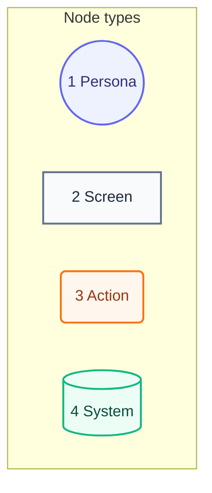
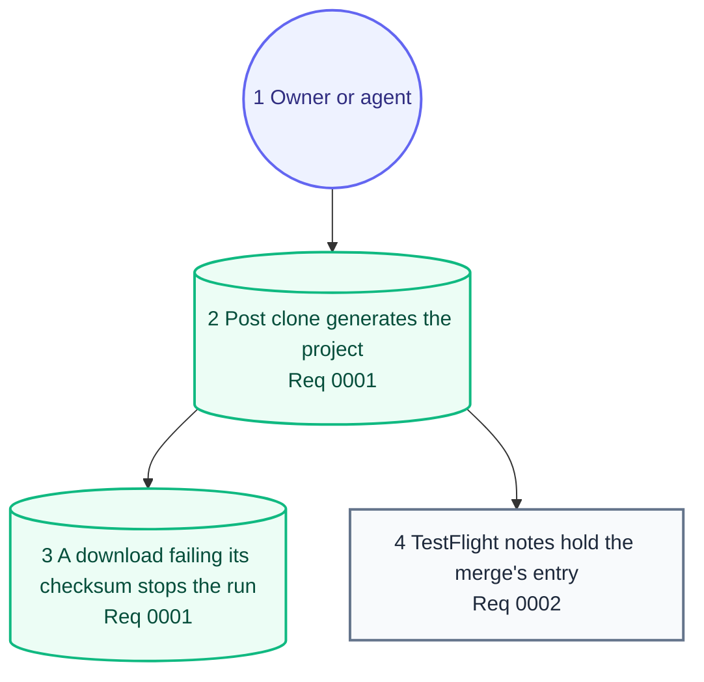

# User Journey

## Legend

Numbers match the callout table. A "screen" is a pull request page or TestFlight, since the tooling has no GUI.

| #   | Description | Why |
| --- | --- | --- |
| 1   | Persona | The owner or an agent; both use pull requests. |
| 2   | Screen | What the person reads. |
| 3   | Action | A merge the person performs. |
| 4   | System | A step that runs by itself. |

## Journey

Numbers match the callout table. Components: [03-components.md](03-components.md).

| #   | Description | Type | Why |
| --- | --- | --- | --- |
| 1   | Owner or agent. | Persona | Same path for both. |
| 2   | The app's shim runs this release's post-clone script from the app's root. | System | One XcodeGen version, per [0001](../requirements/0001-post-clone.md). |
| 3   | A download that fails its SHA-256 exits 1, naming the checksum. | System | No unverified binary runs, per 0001.1. |
| 4   | After the archive, the What to Test notes. | Screen | Written per [0002](../requirements/0002-tester-notes.md). |
